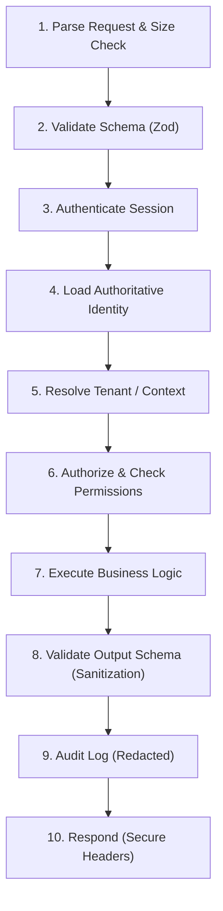
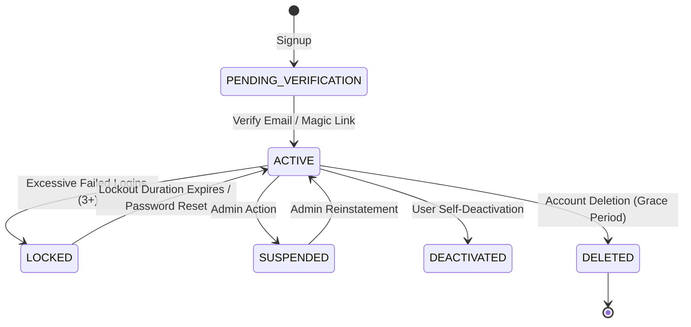

# Module 01: Unified Authentication & User Management — Architecture Summary

## 1. Architectural Philosophy & Independence

This module is designed for the **Personal Product Factory**. It adheres strictly to the **Single-Product Independence Rule**:
- **Completely Independent**: It does NOT assume multiple products reside in one centralized application or database.
- **Portable & Adaptable**: Can be directly copied, installed via package manager, or adapted into each independent product repository.
- **Provider-Agnostic**: Core application business logic never binds to provider-specific APIs. Standard adapters are provided for Custom Database, Supabase Auth, Clerk, and Auth.js.

---

## 2. Directory Structure

```
auth/
├── server/               # Core server-side services (scrypt hashing, TOTP, sessions, tokens, rate limiter)
├── client/               # Frontend React context, hooks (useAuth, useSession, useMFA), and AuthClient
├── components/           # Reusable, accessible UI components (LoginForm, SignupForm, MFASetup, etc.)
├── middleware/           # Pipeline middleware (Auth, CSRF double-submit, RateLimit, Permissions, Security Headers)
├── providers/            # Clean provider abstraction (Custom, Supabase, Clerk, Auth.js)
├── schemas/              # Strict Zod schemas for request/response validation
├── tests/                # 13 test suites with 66 comprehensive tests (including all 25 security audit tests)
└── docs/                 # Production-readiness documentation and checklists
```

---

## 3. The 10-Step Server Pipeline

Every sensitive endpoint follows the formal 10-step server execution boundary:



> [!IMPORTANT]
> The server NEVER accepts `userId`, `role`, `permissions`, or `organizationId` from client requests as trusted values. Identity and permissions are always loaded authoritatively from the server session and database.

---

## 4. Identity & Account State Machine



- **Authentication Invariants**: Accounts in `SUSPENDED`, `DEACTIVATED`, `LOCKED`, or `DELETED` states are strictly rejected from authenticating.
- **Timing-Safe Rejections**: Non-existent or deleted accounts execute a constant-time dummy scrypt verification to prevent account enumeration.

---

## 5. Session Lifecycle & Token Handling

- **Token Generation**: Cryptographically secure 256-bit entropy (`crypto.randomBytes(32)`).
- **Storage at Rest**: Tokens are **never stored in plaintext** in the database. Only their SHA-256 hashes (`tokenHash`) are stored.
- **Session Fixation Prevention**: Session identifiers are rotated immediately after authentication.
- **Inactivity Timeout**: Configurable sliding expiration (default 30 minutes).
- **Absolute Lifetime**: Configurable maximum session duration (default 14 days).
- **Global Revocation Mechanism**: `user.sessionVersion` integer. Any increment immediately invalidates all active sessions globally without requiring database deletion sweeps.
- **Automatic Invalidation Triggers**:
  - Password change
  - Password reset
  - Email change
  - MFA activation / removal
  - Admin privilege modification
  - "Logout from all devices"
