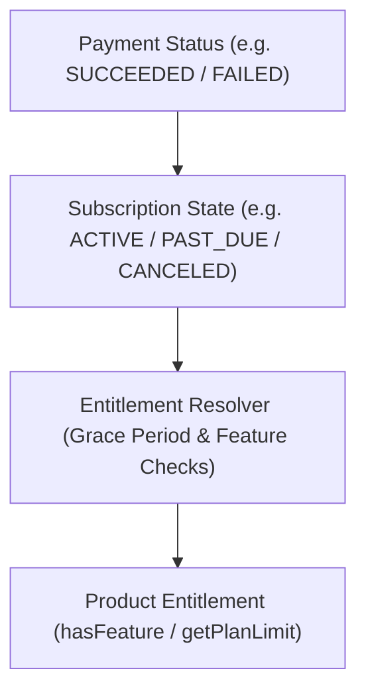
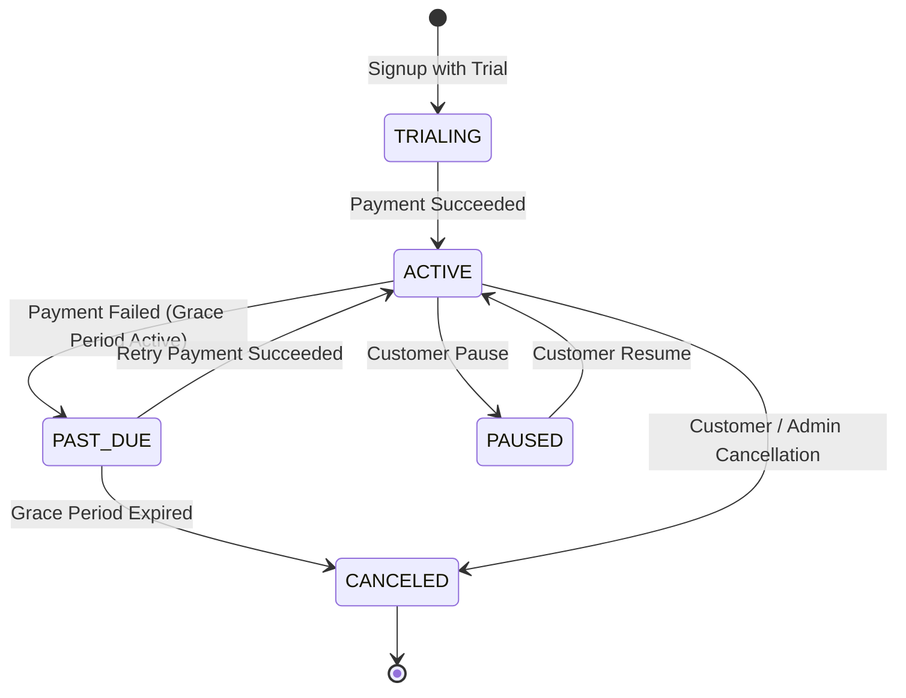

# Module 02: Payment Gateway & Subscription Engine — Architecture Summary

## 1. Architectural Philosophy & Independence

This module is designed for the **Personal Product Factory**. It is **100% independent from Module 01 (Authentication)**:
- **No Cross-Module Dependencies**: Module 02 operates on independent `customerId` identifiers and does not import from `auth/`.
- **Provider-Independent**: Application code never interacts directly with Stripe, Paddle, or Lemon Squeezy SDKs. It uses standard abstractions:
  - `getSubscription()`
  - `hasActivePlan()`
  - `hasFeature()`
  - `getPlanLimit()`
  - `cancelSubscription()`
  - `createCheckout()`
  - `createBillingPortalSession()`

---

## 2. Directory Structure

```
billing/
├── server/               # Core services (BillingService, EntitlementResolver, WebhookEngine, TaxEngine, Money)
├── client/               # Frontend client, React context (<BillingProvider />), and hooks
├── components/           # Reusable UI components (<Pricing />, <Checkout />, <Subscription />, <Invoices />, etc.)
├── providers/            # Provider adapters (Stripe, Paddle, Lemon Squeezy)
├── schemas/              # Strict Zod schemas for all billing models, financial states, and price snapshots
├── tests/                # 7 test suites testing money, subscriptions, webhooks, entitlements, taxes, refunds, reconciliation
└── docs/                 # Production-readiness documentation and checklists
```

---

## 3. Entitlement Resolution Pipeline



> [!IMPORTANT]
> A product should never scatter `if (paid === true)` throughout the application. Product code always queries `hasFeature()` or `getPlanLimit()` through the `EntitlementResolver`.

---

## 4. Financial State Machine (Page 15)



- **Payment Statuses**: `PENDING`, `SUCCEEDED`, `FAILED`, `REFUNDED`, `PARTIALLY_REFUNDED`, `DISPUTED`, `CANCELED`.
- **Invoice Statuses**: `DRAFT`, `OPEN`, `PAID`, `VOID`, `UNCOLLECTIBLE`.
- **Refund Statuses**: `PENDING`, `SUCCEEDED`, `FAILED`, `REVERSED`.
- **Dispute Statuses**: `WARNING_NEEDS_RESPONSE`, `NEEDS_RESPONSE`, `UNDER_REVIEW`, `WON`, `LOST`.
